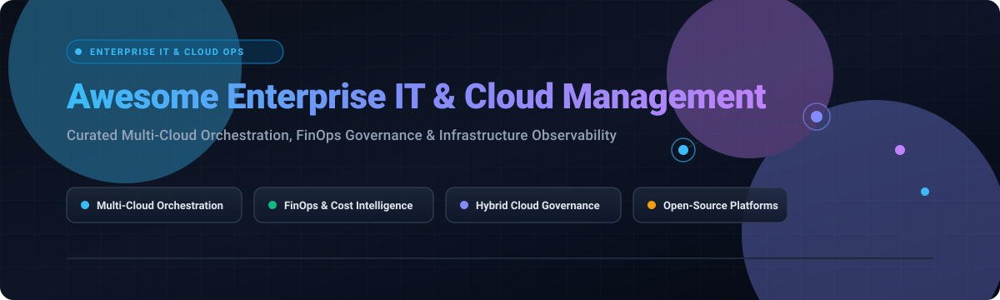

  

# 🌐 Awesome Enterprise IT & Cloud Management

  
  
  
  
  
  

---

## 🚀 Overview & Ecosystem Summary

**A Curated Directory of Enterprise SaaS Platforms & Self-Hosted Open-Source GitHub Projects for Hybrid Cloud Management, FinOps Cost Governance, and Infrastructure Automation.**

As enterprises transition from single hyperscalers to distributed hybrid and multi-cloud architectures (AWS, Microsoft Azure, Google Cloud Platform, and on-premises virtualization), operating consistency is paramount. This repository tracks production-grade **SaaS suites** and **open-source platforms** engineered for provisioning orchestration, cloud financial operations (FinOps), infrastructure observability, compliance enforcement, and cloud cost optimization.

---

## 📊 Sector Overview & Market Dynamics

The global **Cloud Management Platform (CMP) and Multi-Cloud Operations** market is valued at approximately **$21.25B to $25.66B (2025–2026)** and is accelerating at a robust compound annual growth rate (**CAGR of 16% to 21%**), projected to exceed **$55B by 2030**. 

The sector is **moderately to highly fragmented** rather than a winner-take-all monopoly: while mega-cap enterprise providers (Broadcom, IBM, ServiceNow) dominate legacy virtualization suites and ITSM workflows, agile specialist players capture massive market share across container orchestration, AI-native cloud observability (Datadog, Dynatrace), and automated FinOps optimization (CAST AI, Kubecost).

---

## 📑 Table of Contents
- [📊 Sector Overview & Market Dynamics](#-sector-overview--market-dynamics)
- [🏢 Enterprise SaaS & Hosted Platforms](#-enterprise-saas--hosted-platforms)
- [🔓 Top Open-Source GitHub Projects](#-top-open-source-github-projects)
- [📈 Star History](#-star-history)
- [🤝 How to Contribute](#-how-to-contribute)
- [💖 Support](#-support)
- [📄 License & Disclaimer](#-license--disclaimer)

---

## 🏢 Enterprise SaaS & Hosted Platforms

*Enterprise SaaS platforms ranked in descending order by parent company scale (Market Capitalization / Valuation / Revenue).*

| Product | Company Scale (Market Cap / Valuation / Revenue) | Description | Pricing (Starting) | Free Tier / Trial Limits |
|---|---|---|---|---|
| [VMware Cloud Foundation (Broadcom)](https://www.vmware.com/products/cloud-foundation.html) | **~$1.70T Market Cap** (Broadcom / AVGO; ~$89.1B run-rate rev) | Full-stack hybrid cloud platform integrating vSphere, vSAN, NSX, and Aria Suite cloud automation. | $350 to $400/core/year list subscription (minimum 16 cores per CPU socket) | 60-day evaluation mode on ESXi/vSphere and Aria deployments; free access to VMware Hands-On Labs (HOL) |
| [IBM Cloudability](https://www.apptio.com/products/cloudability/) | **~$235B Market Cap** (IBM / IBM; ~$69.9B annual rev) | Multi-cloud FinOps management platform tracking cloud spend, resource allocation, and cost optimization across AWS, Azure, and GCP. | ~$30,000/year (entry-level annual enterprise commitment managing up to $1M cloud spend, ~0.75%–3% spend fee) | 14-day free trial evaluation period |
| [ServiceNow ITOM](https://www.servicenow.com/products/it-operations-management.html) | **~$110B–$160B Market Cap** (ServiceNow / NOW; ~$15.4B annual rev) | Enterprise IT operations management platform providing service mapping, discovery, and automated cloud provisioning. | ~$70 to $200/fulfiller agent/month (ITSM) and ~$0.50 to $1.50/monitored node/month (ITOM) via annual enterprise licensing | No public free trial; Personal Developer Instances (PDIs) available for sandboxed development/learning |
| [HPE Morpheus](https://morpheusdata.com/) | **~$65B–$80B Market Cap** (Hewlett Packard Enterprise / HPE; ~$41.9B annual rev) | Hybrid multi-cloud management and orchestration platform unifying bare metal, hypervisors, and multi-cloud containers. | ~$4,400 to $4,500/socket/year (Enterprise Software tier including ~15 Workload Equivalents) | 60-day full free trial; Community Edition free for up to 3 sockets for non-production/lab use |
| [Datadog](https://www.datadoghq.com/) | **~$65B Market Cap** (Datadog / DDOG; ~$4.3B annual rev) | Cloud-scale observability and IT infrastructure management platform covering metrics, traces, and multi-cloud systems. | $15/host/month (billed annually, Pro tier) or $18/host/month on-demand | Free tier up to 5 hosts with 1-day metric retention; 14-day full-feature free trial |
| [ManageEngine OpManager](https://www.manageengine.com/network-monitoring/) | **~$12.5B Valuation** (Zoho Corp Private; ~$1.5B group rev, ManageEngine ~$600M+) | Integrated IT infrastructure and multi-cloud monitoring suite covering network devices, servers, and virtual machines. | $95/year for 10 devices (Standard tier) or $145/year for 10 devices (Professional tier) | Free Edition limited to 3 devices and 2 user accounts; 30-day fully functional free trial |
| [Dynatrace](https://www.dynatrace.com/) | **~$12B Market Cap** (Dynatrace / DT; ~$2.0B annual ARR) | AI-driven full-stack observability and cloud operations platform supporting hybrid and multi-cloud environments. | $0.01/host-hour (~$7/host/month) for Discovery; $0.04/host-hour (~$29/host/month) for Infrastructure Monitoring | 15-day free trial with full platform access (no credit card required; no permanent free tier) |
| [SolarWinds Observability](https://www.solarwinds.com/hybrid-cloud-observability) | **~$3.2B Acquisition / Valuation** (Turn/River Capital; ~$800M annual rev) | Hybrid cloud and IT operations management platform for comprehensive on-premises, private, and public cloud visibility. | $7.42/node/month billed annually (~$89/node/year) | 30-day fully functional free trial (no credit card required; no permanent free tier) |
| [CAST AI](https://cast.ai/) | **>$1.0B Valuation (Unicorn)** (~$196M total venture funding raised) | Autonomous multi-cloud Kubernetes cost optimization, autoscaling, and compute governance platform. | $1,000/month base platform fee + $0.0069/vCPU-hour (~$5/vCPU/month) | Free tier offering read-only Kubernetes cost monitoring & analytics across unlimited clusters |
| [Kubecost Cloud](https://www.kubecost.com/) | **Acquired by IBM / Apptio** (Backed by IBM FinOps portfolio) | Kubernetes-native cloud cost allocation, governance, and capacity optimization platform. | $63.60/vCPU core/year (Enterprise Self-Hosted/Cloud starting bundle from 250 cores) | Free "Foundations" tier up to 250 vCPU cores with 15-day metric retention; 30-day enterprise free trial |

---

## 🔓 Top Open-Source GitHub Projects

*Self-hosted cloud management platforms, multi-cloud control planes, and FinOps engines ranked in descending order by GitHub_Stars.*

| Project | GitHub_Stars | License | Description |
|---|---|---|---|
| [OpenTofu](https://github.com/opentofu/opentofu) |  | `MPL-2.0` | Linux Foundation declarative open-source Infrastructure as Code (IaC) tool for multi-cloud resource provisioning. |
| [Infracost](https://github.com/infracost/infracost) |  | `Apache-2.0` | Cloud cost intelligence and FinOps shift-left tool analyzing Terraform and OpenTofu pull requests before deployment. |
| [Crossplane](https://github.com/crossplane/crossplane) |  | `Apache-2.0` | CNCF graduated cloud-native control plane orchestrating multi-cloud infrastructure and managed services via Kubernetes APIs. |
| [Terragrunt](https://github.com/gruntwork-io/terragrunt) |  | `MIT` | Flexible orchestration tool allowing Infrastructure as Code written in OpenTofu and Terraform to scale across multi-account enterprise clouds. |
| [OpenCost](https://github.com/opencost/opencost) |  | `Apache-2.0` | CNCF sandbox open-source vendor-neutral Kubernetes cloud cost monitoring, allocation, and carbon footprint tracking engine. |
| [Cloud Custodian](https://github.com/cloud-custodian/cloud-custodian) |  | `Apache-2.0` | CNCF rules engine for multi-cloud management, policy enforcement, automatic resource remediation, and cost optimization. |
| [OpenStack](https://github.com/openstack/openstack) |  | `Apache-2.0` | Standard open-source cloud computing platform ubiquitous in private cloud telecommunications and massive data center deployments. |
| [Apache CloudStack](https://github.com/apache/cloudstack) |  | `Apache-2.0` | Mature turnkey open-source Infrastructure as a Service (IaaS) platform for orchestrating large-scale private and public cloud fabrics. |
| [OpenNebula](https://github.com/OpenNebula/one) |  | `Apache-2.0` | Simple yet powerful turnkey open-source cloud & edge computing platform managing virtualized enterprise infrastructures. |
| [ManageIQ](https://github.com/ManageIQ/manageiq) |  | `Apache-2.0` | Full-featured hybrid cloud and IT management appliance delivering discovery, compliance, capacity planning, and automation. |
| [Cloudforet](https://github.com/cloudforet-io/console) |  | `Apache-2.0` | Linux Foundation-backed multi-cloud management platform for unified billing analysis, asset inventory, and security monitoring. |

---

## 🤝 How to Contribute

Contributions are welcome and appreciated! To propose a new platform or update existing entries:

1. 🍴 Fork the repository.
2. 🌿 Create a new feature branch (`git checkout -b feature/add-new-tool`).
3. 📝 Add your entry under the appropriate section in alphabetical or ranked order.
4. 🔍 Ensure all SaaS listings include specific starting tier pricing and exact free tier/trial limits.
5. 🚀 Commit your changes (`git commit -m "feat: add AwesomeTool to Cloud Management list"`).
6. 📬 Open a Pull Request with a clear description and links to official documentation.

---

## 💖 Support

If you found this curated list helpful for your enterprise cloud architecture, please consider showing your support:

- ⭐ **Star this repository** to help others discover it!
- 🍴 **Fork and share** with your DevOps, SRE, and FinOps teams.
- ☕ **Sponsor the maintainer** or buy a coffee via the official [GitHub Sponsor Dashboard](https://github.com/sponsors/ishandutta2007).

Thank you for being part of the open-source and cloud computing community! 🙌

---

## 📈 Star History

---

## 📄 License & Disclaimer

- Distributed under the [MIT License](file:///C:/Users/ishan/Documents/Projects/Awesome-Enterprise-IT-Cloud-Management/LICENSE).
- *Disclaimer:* Pricing tiers, features, and trial limits are subject to change by respective vendors. Please verify directly with official product websites for production licensing requirements.
